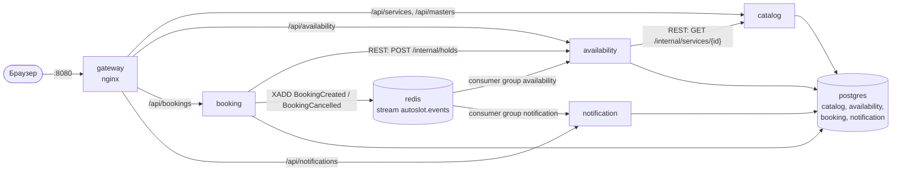
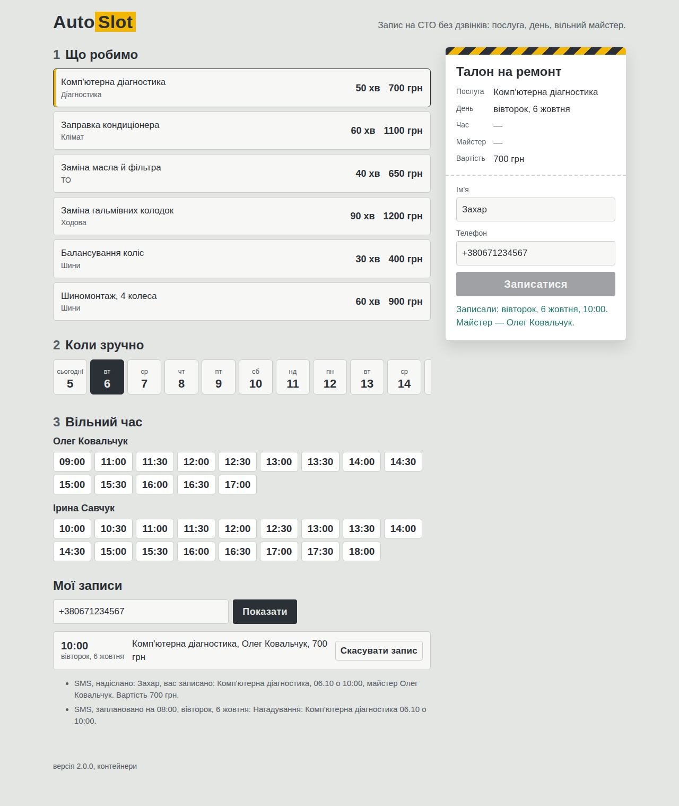

# Звіт до лабораторної роботи 2

**Дисципліна:** Хмарні та GRID-технології
**Викладач:** Жереб К. А.
**Завдання:** Лабораторна робота 2. Розробка застосунку з використанням контейнерів
**Варіант:** тема обрана бригадою
**Виконали:** Захарчук Захар Сергійович, Кондрасюк Ярослав Володимирович, група ІТ-51мн
**Код:** [https://github.com/yaroslavkondrasiuk/autoslot-cloud/tree/cloud-lab2/lab2-containers](https://github.com/yaroslavkondrasiuk/autoslot-cloud/tree/cloud-lab2/lab2-containers) (тег `cloud-lab2`)

## 1. Розподіл обов'язків

Запланований розподіл; фактичний внесок видно в історії комітів.

| Учасник | Роль | Компоненти та розділи звіту |
| --- | --- | --- |
| Захарчук Захар Сергійович | backend-розробник | `catalog-service`, `availability-service`, шина подій на Redis Streams, Dockerfile сервісів; Dockerfile, PostgreSQL, Redis Streams у розділі 3 |
| Кондрасюк Ярослав Володимирович | backend-розробник, DevOps, тестувальник | `booking-service`, `notification-service`, gateway, `docker-compose.yml`, smoke-тест; решта розділів |

## 2. Що реалізовано

Застосунок AutoSlot з лабораторної роботи 1 розділено на сервіси за
baseline-архітектурою v1.0 з проєкту з мікросервісів: у кожного сервісу власні
дані, слоти належать `availability-service`, утримання слоту виконується через
hold з TTL та ідемпотентним ключем, а сповіщення працюють через події, без
синхронних викликів. Система запускається однією командою як набір із семи
контейнерів. Оплата й автентифікація в цю роботу не входять.

| Контейнер | Образ | Роль | Порт назовні |
| --- | --- | --- | --- |
| `gateway` | власний, на `nginx:1.27-alpine` | веб-клієнт і маршрутизація `/api/*` до сервісів | 8080 |
| `catalog` | власний, на `python:3.12-slim` | послуги, ціни, тривалість, майстри | — |
| `availability` | власний | графіки, вільні слоти, hold з TTL; споживач подій | — |
| `booking` | власний | життєвий цикл запису; публікує події | — |
| `notification` | власний | SMS-підтвердження й нагадування; споживач подій | — |
| `postgres` | `postgres:16-alpine` | окрема БД для кожного сервісу | — |
| `redis` | `redis:7-alpine` | шина подій (Redis Streams) | — |



Сценарій запису: `booking` синхронно просить `availability` утримати слот.
`availability` під блокуванням рядка графіка майстра перевіряє перетин
інтервалів і створює hold на 5 хвилин. Далі `booking` зберігає запис і публікує
`BookingCreated`. За цією подією `availability` переводить hold у
підтверджений слот, а `notification` надсилає підтвердження й планує
нагадування за 24 і за 2 години.

## 3. Використані технології та їхні можливості

**Dockerfile** ([reference](https://docs.docker.com/reference/dockerfile/)). Для
чотирьох Python-сервісів використано один `services/Dockerfile`; сервіс
обирається аргументом збірки [`ARG SERVICE`](https://docs.docker.com/reference/dockerfile/#arg),
а спільний код (`services/common/`) копіюється в кожен образ:

```dockerfile
ARG SERVICE
COPY requirements.txt .
RUN pip install --no-cache-dir -r requirements.txt   # окремий шар, кешується
COPY common ./common
COPY ${SERVICE} ./app
USER appuser
HEALTHCHECK CMD python -c "import urllib.request; urllib.request.urlopen('http://127.0.0.1:8000/health', timeout=2)"
```

Залежності встановлюються до копіювання коду, тож при зміні коду шар з
`pip install` береться з [кешу збірки](https://docs.docker.com/build/cache/).
Процес працює від непривілейованого користувача ([`USER`](https://docs.docker.com/reference/dockerfile/#user)).
[`HEALTHCHECK`](https://docs.docker.com/reference/dockerfile/#healthcheck) звертається до
`/health`, який перевіряє й з'єднання з БД.

**Docker Compose** ([compose file reference](https://docs.docker.com/reference/compose-file/services/)). Використані можливості:

- [`build.args`](https://docs.docker.com/reference/compose-file/build/#args) — один Dockerfile дає чотири різні образи;
- [`depends_on` з `condition: service_healthy`](https://docs.docker.com/reference/compose-file/services/#depends_on) — сервіс стартує лише
  після того, як залежності пройшли health check (postgres і redis, потім catalog, availability, booking і notification, останнім — gateway);
- [`healthcheck`](https://docs.docker.com/reference/compose-file/services/#healthcheck) для `postgres` (`pg_isready`) і `redis` (`redis-cli ping`);
- [іменовані томи](https://docs.docker.com/reference/compose-file/volumes/) `pgdata` і `redisdata` — дані переживають перезапуск і перестворення контейнерів;
- [мережа за замовчуванням](https://docs.docker.com/compose/how-tos/networking/) — сервіси знаходять один одного за іменем (`http://catalog:8000`), назовні опубліковано лише порт gateway;
- [підстановка змінних](https://docs.docker.com/compose/how-tos/environment-variables/variable-interpolation/) з `.env`; `${POSTGRES_PASSWORD:?...}` зупиняє запуск, якщо пароль не задано;
- [YAML-фрагменти](https://docs.docker.com/reference/compose-file/fragments/) (`x-python-env: &python-env`) для спільних змінних оточення;
- `restart: unless-stopped` — контейнер перезапускається після збою.

**PostgreSQL в образі `postgres`** ([Docker Hub, розділ Initialization scripts](https://hub.docker.com/_/postgres)).
Скрипт `postgres/init-databases.sql`, змонтований у
`/docker-entrypoint-initdb.d/`, при першому старті створює чотири окремі бази,
по одній на сервіс. Сервіси не мають доступу до таблиць один одного.

**Redis Streams** ([документація](https://redis.io/docs/latest/develop/data-types/streams/)) — шина подій (`services/common/events.py`).
`booking` додає подію командою `XADD`. Кожен сервіс-споживач має власну consumer
group і читає через [`XREADGROUP`](https://redis.io/docs/latest/commands/xreadgroup/):
кожна група отримує всі події, а всередині групи подію обробляє лише один
екземпляр. Підтвердження [`XACK`](https://redis.io/docs/latest/commands/xack/)
надсилається тільки після успішної обробки, тому подія не губиться, якщо
споживач був недоступний. Доставка відбувається щонайменше один раз, отже
обробники ідемпотентні: `notification` має унікальний ключ `(event_id, kind)`,
а `availability` просто встановлює статус.

**nginx як API gateway** ([proxy_pass](https://nginx.org/en/docs/http/ngx_http_proxy_module.html#proxy_pass)).
Gateway віддає статичний веб-клієнт і за префіксом шляху проксує запити до
потрібного сервісу. Шляхи `/internal/*` назовні повертають 404. Кожен запит
отримує заголовок `X-Request-ID` ([`$request_id`](https://nginx.org/en/docs/http/ngx_http_core_module.html#var_request_id)) для трасування.
Веб-клієнт той самий, що й у лабораторній 1: шляхи API збігаються, тому зміна
архітектури для клієнта непомітна. Додано лише блок сповіщень.

## 4. Порівняння з альтернативами

| Задача | Обрано | Альтернативи | Чому так |
| --- | --- | --- | --- |
| оркестрація | Docker Compose | Kubernetes, Docker Swarm | для 7 контейнерів на одному хості Compose достатньо; Kubernetes дав би масштабування й самовідновлення на кількох вузлах ціною значно складнішої конфігурації |
| шина подій | Redis Streams | RabbitMQ, Kafka | consumer groups і підтвердження є «з коробки», один легкий контейнер; RabbitMQ дає гнучкішу маршрутизацію, Kafka — масштаб і довге зберігання, але обидва важчі для навчального проєкту |
| gateway | nginx | Traefik, Kong | статичний конфіг на кілька маршрутів простий і прозорий; Traefik зручніший для автоматичного виявлення контейнерів за мітками |
| БД | одна інстанція PostgreSQL, 4 бази | окремий контейнер БД на сервіс | ізоляція даних зберігається, а ресурсів потрібно менше |

## 5. Запуск

Потрібні Docker і Docker Compose v2.

```bash
cd lab2-containers
cp .env.example .env              # задати POSTGRES_PASSWORD
docker compose up -d --build      # збірка 5 образів і старт 7 контейнерів
docker compose ps                 # усі мають бути у стані healthy
# http://localhost:8080
docker compose logs -f notification   # «надіслані» SMS
docker compose down               # зупинити (дані лишаються в томах)
docker compose down -v            # зупинити й видалити дані
```

**Розгортання в хмарі.** Достатньо віртуальної машини з Docker (наприклад,
Azure VM або AWS EC2): на ній виконуються ті самі команди, а в правилах
мережевого доступу відкривається лише порт 8080.

## 6. Тестування

Скрипт `scripts/smoke_test.py` перевіряє всю систему через gateway. Він
використовує лише стандартну бібліотеку Python, тож запускається з будь-якої машини:

```text
$ python scripts/smoke_test.py http://localhost:8080
OK   каталог через gateway (6 послуг)
OK   вільні слоти на 2026-10-07 (32)
OK   8 паралельних запитів на один слот: [201, 409, 409, 409, 409, 409, 409, 409]
OK   слот зник із вільних
OK   notification-service отримав BookingCreated (3 сповіщ.)
OK   скасування
OK   слот повернувся після BookingCancelled
OK   нагадування скасовані, є SMS про скасування
OK   внутрішнє API закрите на gateway
Усі перевірки пройдено.
```

Перевірка відмовостійкості: при зупиненому сервісі `notification` запис створюється
успішно (`201`). Подія чекає в потоці, і для групи `notification` значення
`lag` дорівнює 1. Після запуску сервісу подія обробляється, клієнт отримує
підтвердження, а `lag` повертається до 0. Отже, збій сервісу сповіщень не
блокує запис, що й було метою переходу від синхронних викликів до подій.

```bash
docker compose stop notification
python scripts/smoke_test.py      # падає лише на кроці сповіщень, запис працює
docker compose exec redis redis-cli XINFO GROUPS autoslot.events
docker compose start notification
```

## 7. Скріншоти



Рис. 1 — запис через gateway; внизу сповіщення, які сформував `notification-service` за подією `BookingCreated`

## 8. Обмеження

- Подія публікується після коміту в БД. Якщо Redis недоступний саме в цей
  момент, запис збережеться без події, і hold через 5 хвилин стане EXPIRED.
  Надійне рішення — шаблон transactional outbox.
- Подія, обробка якої завершилась помилкою, лишається в pending і
  повторюється лише після перезапуску споживача; черги «мертвих» повідомлень немає.
- nginx визначає IP-адреси сервісів під час старту; якщо контейнер сервісу
  перестворено, gateway потрібно перезапустити.

## 9. Висновки

Застосунок оформлено як набір із семи контейнерів, описаних у
`docker-compose.yml`. Один параметризований Dockerfile збирає чотири
Python-сервіси, health checks і `depends_on` задають правильний порядок старту,
томи зберігають дані, а назовні відкритий лише gateway. Асинхронні події через
Redis Streams зменшили зв'язність: збій сервісу сповіщень не впливає на запис,
а пропущені події обробляються після відновлення. Порівняно з лабораторною 1
система стала складнішою в розгортанні, але сервіси можна змінювати,
перезапускати й масштабувати окремо. Це буде основою для порівняння монолітної
та мікросервісної версій у лабораторній роботі 3.
