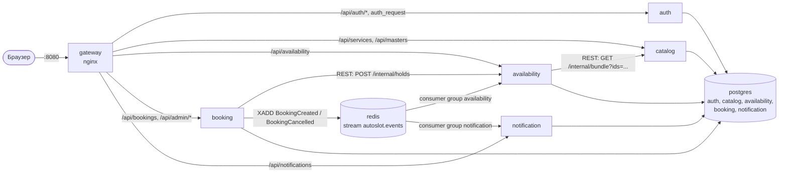
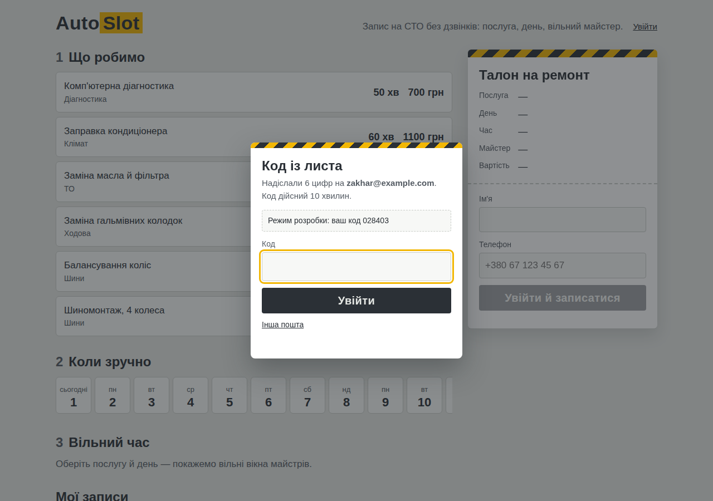
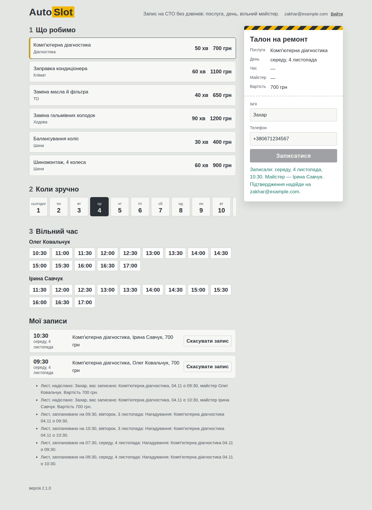
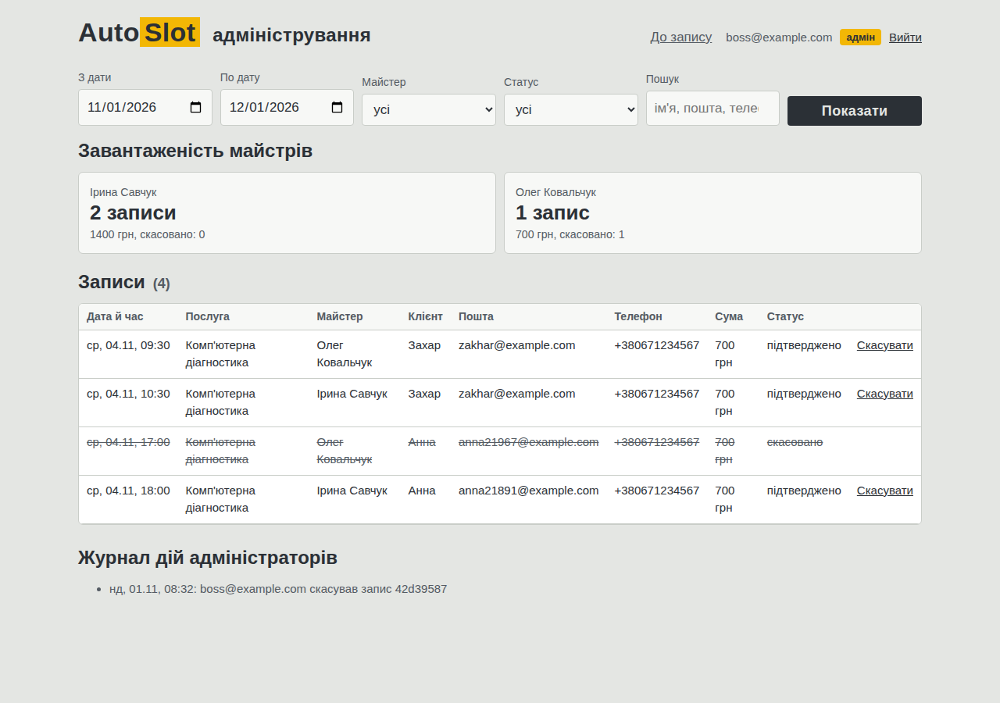

# Звіт до лабораторної роботи 2

**Дисципліна:** Хмарні та GRID-технології
**Викладач:** Жереб К. А.
**Завдання:** Лабораторна робота 2. Розробка застосунку з використанням контейнерів
**Варіант:** тема обрана бригадою
**Виконали:** Захарчук Захар Сергійович, Кондрасюк Ярослав Володимирович, група ІТ-51мн
**Код:** [https://github.com/yaroslavkondrasiuk/autoslot-cloud/tree/cloud-lab2/lab2-containers](https://github.com/yaroslavkondrasiuk/autoslot-cloud/tree/cloud-lab2/lab2-containers) (тег `cloud-lab2`)

## 1. Розподіл обов'язків

Запланований розподіл; фактичний внесок видно в історії комітів.

| Учасник | Роль | Компоненти та розділи звіту |
| --- | --- | --- |
| Захарчук Захар Сергійович | backend-розробник | `auth-service` (коди з пошти, паролі scrypt, JWT, ролі), `catalog-service` і `availability-service` (зокрема кілька послуг за один візит), шина подій на Redis Streams, Dockerfile сервісів, модульні тести, Prometheus і Grafana; Dockerfile, PostgreSQL, Redis Streams і автентифікація в розділі 3 |
| Кондрасюк Ярослав Володимирович | backend-розробник, DevOps, frontend, тестувальник | `booking-service` (доступ до власних записів, адмін-API, стрічка активності), `notification-service`, gateway (перевірка входу, security-заголовки, обмеження частоти), веб-клієнт і адмін-панель, `docker-compose.yml`, smoke-тест; решта розділів |

## 2. Що реалізовано

Застосунок AutoSlot з лабораторної роботи 1 розділено на сервіси за
baseline-архітектурою v1.0 з проєкту з мікросервісів: у кожного сервісу власні
дані, слоти належать `availability-service`, утримання слоту виконується через
hold з TTL та ідемпотентним ключем, а сповіщення працюють через події, без
синхронних викликів. Система запускається однією командою: п'ять Python-сервісів
(кожен у `REPLICAS` копіях, за замовчуванням 2), gateway, PostgreSQL і Redis, а з
профілем `monitoring` — ще Prometheus і Grafana. Оплата в цю роботу не входить.

Можливості застосунку:

- **реєстрація і вхід:** пошта підтверджується одноразовим кодом із листа (SMTP,
  наприклад Gmail), далі користувач входить за паролем; сесія — JWT у HttpOnly-cookie;
- **ролі:** клієнт бачить і скасовує лише власні записи, адміністратор (`ADMIN_EMAILS`) — усі;
- **запис на одну або кілька послуг за один візит** (до 6): їх виконує один майстер
  підряд, тривалість і ціна сумуються, пропонуються лише майстри, які вміють усі послуги;
- **адмін-панель** (`/admin.html`) з вкладками «Записи» (фільтри, скасування),
  «Майстри» (графіки й завантаженість) і «Активність» (стрічка нових записів і скасувань);
- **листи** з підтвердженням, нагадуваннями за 24 і за 2 години та про скасування;
- **метрики** кожного сервісу для Prometheus (ЛР4).

| Контейнер | Образ | Роль | Порт назовні |
| --- | --- | --- | --- |
| `gateway` | власний, на `nginx:1.27-alpine` | веб-клієнт, маршрутизація `/api/*`, перевірка входу, балансування між репліками, обмеження частоти | 8080 |
| `auth` | власний, на `python:3.12-slim` | реєстрація, коди з пошти, паролі, JWT, ролі | — |
| `catalog` | власний | послуги, ціни, тривалість, майстри; набори послуг | — |
| `availability` | власний | графіки, вільні слоти, hold з TTL; споживач подій | — |
| `booking` | власний | життєвий цикл запису; публікує події | — |
| `notification` | власний | листи-підтвердження, нагадування й скасування; споживач подій | — |
| `postgres` | `postgres:16-alpine` | окрема БД для кожного сервісу (5 баз) | — |
| `redis` | `redis:7-alpine` | шина подій (Redis Streams) | — |
| `prometheus`, `grafana` | `prom/prometheus`, `grafana/grafana` | метрики й дашборд (профіль `monitoring`, ЛР4) | 9090 (лише localhost), 3000 |



Сценарій запису: gateway перевіряє сесію через `auth` (підзапит
[`auth_request`](https://nginx.org/en/docs/http/ngx_http_auth_request_module.html))
і передає в `booking` заголовки `X-User-Id`, `X-User-Email`, `X-User-Role`.
`booking` синхронно просить `availability` утримати слот.
`availability` під блокуванням рядка графіка майстра перевіряє перетин
інтервалів і створює hold на 5 хвилин. Для кількох послуг `availability`
отримує в `catalog` сумарну тривалість і спільних майстрів (`/internal/bundle`),
тож увесь візит резервується одним інтервалом. Далі `booking` зберігає запис і публікує
`BookingCreated`. За цією подією `availability` переводить hold у
підтверджений слот, а `notification` надсилає підтвердження й планує
нагадування за 24 і за 2 години.

## 3. Використані технології та їхні можливості

**Dockerfile** ([reference](https://docs.docker.com/reference/dockerfile/)). Для
чотирьох Python-сервісів використано один `services/Dockerfile`; сервіс
обирається аргументом збірки [`ARG SERVICE`](https://docs.docker.com/reference/dockerfile/#arg),
а спільний код (`services/common/`) копіюється в кожен образ:

```dockerfile
ARG SERVICE
COPY requirements.txt .
RUN pip install --no-cache-dir -r requirements.txt   # окремий шар, кешується
COPY common ./common
COPY ${SERVICE} ./app
USER appuser
HEALTHCHECK CMD python -c "import urllib.request; urllib.request.urlopen('http://127.0.0.1:8000/health', timeout=2)"
```

Залежності встановлюються до копіювання коду, тож при зміні коду шар з
`pip install` береться з [кешу збірки](https://docs.docker.com/build/cache/).
Процес працює від непривілейованого користувача ([`USER`](https://docs.docker.com/reference/dockerfile/#user)).
[`HEALTHCHECK`](https://docs.docker.com/reference/dockerfile/#healthcheck) звертається до
`/health`, який перевіряє й з'єднання з БД.

**Docker Compose** ([compose file reference](https://docs.docker.com/reference/compose-file/services/)). Використані можливості:

- [`build.args`](https://docs.docker.com/reference/compose-file/build/#args) — один Dockerfile дає чотири різні образи;
- [`depends_on` з `condition: service_healthy`](https://docs.docker.com/reference/compose-file/services/#depends_on) — сервіс стартує лише
  після того, як залежності пройшли health check (postgres і redis, потім catalog, availability, booking і notification, останнім — gateway);
- [`healthcheck`](https://docs.docker.com/reference/compose-file/services/#healthcheck) для `postgres` (`pg_isready`) і `redis` (`redis-cli ping`);
- [іменовані томи](https://docs.docker.com/reference/compose-file/volumes/) `pgdata` і `redisdata` — дані переживають перезапуск і перестворення контейнерів;
- [мережа за замовчуванням](https://docs.docker.com/compose/how-tos/networking/) — сервіси знаходять один одного за іменем (`http://catalog:8000`), назовні опубліковано лише порт gateway;
- [підстановка змінних](https://docs.docker.com/compose/how-tos/environment-variables/variable-interpolation/) з `.env`; `${POSTGRES_PASSWORD:?...}` зупиняє запуск, якщо пароль не задано;
- [YAML-фрагменти](https://docs.docker.com/reference/compose-file/fragments/) (`x-python-env: &python-env`) для спільних змінних оточення;
- `restart: unless-stopped` — контейнер перезапускається після збою.

**PostgreSQL в образі `postgres`** ([Docker Hub, розділ Initialization scripts](https://hub.docker.com/_/postgres)).
Скрипт `postgres/init-databases.sql`, змонтований у
`/docker-entrypoint-initdb.d/`, при першому старті створює чотири окремі бази,
по одній на сервіс. Сервіси не мають доступу до таблиць один одного.

**Redis Streams** ([документація](https://redis.io/docs/latest/develop/data-types/streams/)) — шина подій (`services/common/events.py`).
`booking` додає подію командою `XADD`. Кожен сервіс-споживач має власну consumer
group і читає через [`XREADGROUP`](https://redis.io/docs/latest/commands/xreadgroup/):
кожна група отримує всі події, а всередині групи подію обробляє лише один
екземпляр. Підтвердження [`XACK`](https://redis.io/docs/latest/commands/xack/)
надсилається тільки після успішної обробки, тому подія не губиться, якщо
споживач був недоступний. Доставка відбувається щонайменше один раз, отже
обробники ідемпотентні: `notification` має унікальний ключ `(event_id, kind)`,
а `availability` просто встановлює статус.

**Автентифікація** (`services/auth/main.py`). Реєстрація: `POST /api/auth/request-code`
надсилає 6-значний код (генератор [`secrets`](https://docs.python.org/3/library/secrets.html),
у БД — лише HMAC-хеш, діє 10 хв), `POST /api/auth/verify` перевіряє код і зберігає
хеш пароля [`hashlib.scrypt`](https://docs.python.org/3/library/hashlib.html#hashlib.scrypt)
з випадковою сіллю. Далі `POST /api/auth/login` — вхід за паролем без листа; після 5
невдалих спроб вхід блокується на 15 хв. Сесія — JWT ([PyJWT](https://pyjwt.readthedocs.io/en/stable/usage.html)),
підписаний `AUTH_SECRET`, у cookie з прапорцями `HttpOnly`, `SameSite=Lax` і `Secure`
(за `COOKIE_SECURE=true`). Листи надсилає `common/mailer.py` через
[`smtplib`](https://docs.python.org/3/library/smtplib.html) зі STARTTLS; для Gmail
задаються `SMTP_HOST=smtp.gmail.com` і [пароль застосунку](https://support.google.com/accounts/answer/185833).
Без SMTP лист пишеться в журнал контейнера, а з `AUTH_DEV_MODE=true` код показується
на сторінці (лише для локальної розробки). JWT перевіряється в одному місці — на
gateway; сервіси читають готові заголовки `X-User-*` (`common/identity.py`), а роль
`ADMIN` перевіряється на сервері (403 для клієнта).

**nginx як API gateway** ([proxy_pass](https://nginx.org/en/docs/http/ngx_http_proxy_module.html#proxy_pass)).
Gateway віддає статичний веб-клієнт і за префіксом шляху проксує запити до
потрібного сервісу. Шляхи `/internal/*`, `/metrics` і `/docs` назовні повертають 404.
Для `/api/bookings`, `/api/admin/*` і `/api/notifications` спершу виконується
`auth_request`; заголовки `X-User-*` від клієнта перезаписуються значеннями з `auth`,
тому підробити роль неможливо. [`limit_req`](https://nginx.org/en/docs/http/ngx_http_limit_req_module.html)
обмежує частоту запитів (запит коду — 5 за хвилину з IP), а `upstream` з `resolve`
розподіляє запити між усіма репліками сервісу (заголовок `X-Upstream` показує, яка
відповіла). Додано заголовки безпеки: CSP без inline-скриптів, `X-Frame-Options: DENY`. Кожен запит
отримує заголовок `X-Request-ID` ([`$request_id`](https://nginx.org/en/docs/http/ngx_http_core_module.html#var_request_id)) для трасування.
Веб-клієнт розвиває клієнт лабораторної 1: шляхи каталогу й слотів збігаються,
додано вікно входу й реєстрації (`auth.js`), вибір кількох послуг, «Мої записи» і
адмін-панель.

**Репліки** ([`deploy.replicas`](https://docs.docker.com/reference/compose-file/deploy/#replicas)).
Кожен Python-сервіс запускається в `REPLICAS` копіях. Схему БД створює одна репліка
під advisory lock PostgreSQL, міграції ідемпотентні (наявні бази оновлюються без
втрати даних), подію з Redis обробляє одна репліка групи, а нагадування —
одна завдяки `SELECT … FOR UPDATE SKIP LOCKED`.

## 4. Порівняння з альтернативами

| Задача | Обрано | Альтернативи | Чому так |
| --- | --- | --- | --- |
| оркестрація | Docker Compose | Kubernetes, Docker Swarm | для кількох сервісів з репліками на одному хості Compose достатньо; Kubernetes дав би масштабування й самовідновлення на кількох вузлах ціною значно складнішої конфігурації |
| шина подій | Redis Streams | RabbitMQ, Kafka | consumer groups і підтвердження є «з коробки», один легкий контейнер; RabbitMQ дає гнучкішу маршрутизацію, Kafka — масштаб і довге зберігання, але обидва важчі для навчального проєкту |
| gateway | nginx | Traefik, Kong | статичний конфіг на кілька маршрутів простий і прозорий; Traefik зручніший для автоматичного виявлення контейнерів за мітками |
| БД | одна інстанція PostgreSQL, 5 баз | окремий контейнер БД на сервіс | ізоляція даних зберігається, а ресурсів потрібно менше |
| автентифікація | власний auth-service + JWT | Keycloak, Auth0, AWS Cognito | вхід за кодом і паролем — кілька сотень рядків; Keycloak дав би OAuth2/OIDC і SSO, але це ще один важкий контейнер, а хмарні сервіси прив'язують до провайдера |

## 5. Запуск

Потрібні Docker і Docker Compose v2.

```bash
cd lab2-containers
cp .env.example .env              # задати POSTGRES_PASSWORD, AUTH_SECRET, ADMIN_EMAILS
docker compose up -d --build      # збірка 6 образів, старт сервісів (по 2 репліки)
docker compose ps                 # усі мають бути у стані healthy
# http://localhost:8080 — запис, http://localhost:8080/admin.html — адмін-панель
docker compose logs -f auth       # коди входу, якщо SMTP не налаштовано
docker compose logs -f notification   # листи клієнтам
docker compose --profile monitoring up -d   # + Prometheus і Grafana (:3000)
docker compose down               # зупинити (дані лишаються в томах)
docker compose down -v            # зупинити й видалити дані
```

Щоб листи приходили на справжню пошту, у `.env` задаються `SMTP_HOST=smtp.gmail.com`,
`SMTP_USER`, `SMTP_PASSWORD` (пароль застосунку Google) і `AUTH_DEV_MODE=false`.
Детальний опис роботи системи — у [HOW_IT_WORKS.md](HOW_IT_WORKS.md).

**Розгортання в хмарі.** Достатньо віртуальної машини з Docker (AWS EC2): на ній
виконуються ті самі команди, а в правилах мережевого доступу відкривається лише
порт 8080. Створення ВМ і розгортання автоматизовано в лабораторній 4 (Terraform і
GitHub Actions).

## 6. Тестування

**Модульні тести** (`services/tests/`, 22 тести) перевіряють auth-service (коди,
паролі, блокування, JWT), доступ до записів (власник, інший клієнт, адмін) і набори
послуг. Потрібен Python 3.12:

```bash
cd services && pip install -r requirements.txt pytest httpx && python -m pytest tests -q
# 22 passed
```

**Smoke-тест** `scripts/smoke_test.py` перевіряє всю систему через gateway. Він
використовує лише стандартну бібліотеку Python і потребує `AUTH_DEV_MODE=true`.
Адмін-перевірки входять під адресою `boss@example.com` (має бути в `ADMIN_EMAILS`)
або під адресою зі змінної `SMOKE_ADMIN_EMAIL`:

```text
$ python scripts/smoke_test.py http://localhost:8080
OK   каталог без входу (6 послуг)
OK   gateway балансує між репліками: ['172.21.0.3:8000', '172.21.0.7:8000']
OK   заголовки безпеки (CSP, X-Frame-Options)
OK   вільні слоти на 2026-11-18 (15)
OK   запис без входу -> 401
OK   підроблені X-User-* без входу -> 401
OK   вхід клієнта за кодом
OK   клієнт з підробленим X-User-Role: ADMIN -> 403
OK   внутрішнє API закрите на gateway
OK   8 паралельних запитів на один слот: [201, 409, 409, 409, 409, 409, 409, 409]
OK   слот зник із вільних
OK   клієнт отримав лист-підтвердження
OK   інший клієнт не бачить чужий запис
OK   інший клієнт не може скасувати чужий запис
OK   адмін бачить записи всіх клієнтів
OK   адмін скасував запис клієнта
OK   дія адміна записана в журнал
OK   слот повернувся після скасування
OK   клієнт отримав лист про скасування
OK   вихід завершує сесію
OK   реєстрація: код з пошти + пароль
OK   невірний пароль -> 400
OK   вхід за паролем без листа
OK   вільні вікна для двох послуг підряд
OK   один запис на дві послуги (Заміна масла й фільтра + Комп'ютерна діагностика)
OK   запис видно в стрічці активності адміна
Усі перевірки пройдено.
```

Перевірка відмовостійкості: при зупиненому сервісі `notification` запис створюється
успішно (`201`). Подія чекає в потоці, і для групи `notification` значення
`lag` дорівнює 1. Після запуску сервісу подія обробляється, клієнт отримує
підтвердження, а `lag` повертається до 0. Отже, збій сервісу сповіщень не
блокує запис, що й було метою переходу від синхронних викликів до подій.

```bash
docker compose stop notification
python scripts/smoke_test.py      # падає лише на кроці сповіщень, запис працює
docker compose exec redis redis-cli XINFO GROUPS autoslot.events
docker compose start notification
```

## 7. Скріншоти



Рис. 1 — вікно входу й реєстрації



Рис. 2 — сторінка запису для клієнта, що увійшов


Рис. 3 — запис через gateway і сповіщення, які сформував `notification-service` за подією `BookingCreated`



Рис. 4 — адмін-панель

## 8. Обмеження

- Подія публікується після коміту в БД. Якщо Redis недоступний саме в цей
  момент, запис збережеться без події, і hold через 5 хвилин стане EXPIRED.
  Надійне рішення — шаблон transactional outbox.
- Подія, обробка якої завершилась помилкою, лишається в pending і
  повторюється лише після перезапуску споживача; черги «мертвих» повідомлень немає.
- Відкликати JWT до закінчення терміну дії (8 год) не можна: вихід лише видаляє
  cookie. Для примусового завершення сесій потрібен список відкликаних токенів.
- `AUTH_DEV_MODE=true` показує код входу на сторінці — лише для локального запуску й smoke-тесту.

## 9. Висновки

Застосунок оформлено як набір контейнерів, описаних у
`docker-compose.yml`. Один параметризований Dockerfile збирає п'ять
Python-сервісів, кожен з яких працює в кількох репліках за nginx, health checks і `depends_on` задають правильний порядок старту,
томи зберігають дані, а назовні відкритий лише gateway. Асинхронні події через
Redis Streams зменшили зв'язність: збій сервісу сповіщень не впливає на запис,
а пропущені події обробляються після відновлення. Окремий auth-service і
перевірка сесії на gateway дали реєстрацію з підтвердженням пошти, ролі й захист
даних клієнтів без дублювання коду в кожному сервісі. Порівняно з лабораторною 1
система стала складнішою в розгортанні, але сервіси можна змінювати,
перезапускати й масштабувати окремо. Це буде основою для порівняння монолітної
та мікросервісної версій у лабораторній роботі 3.
