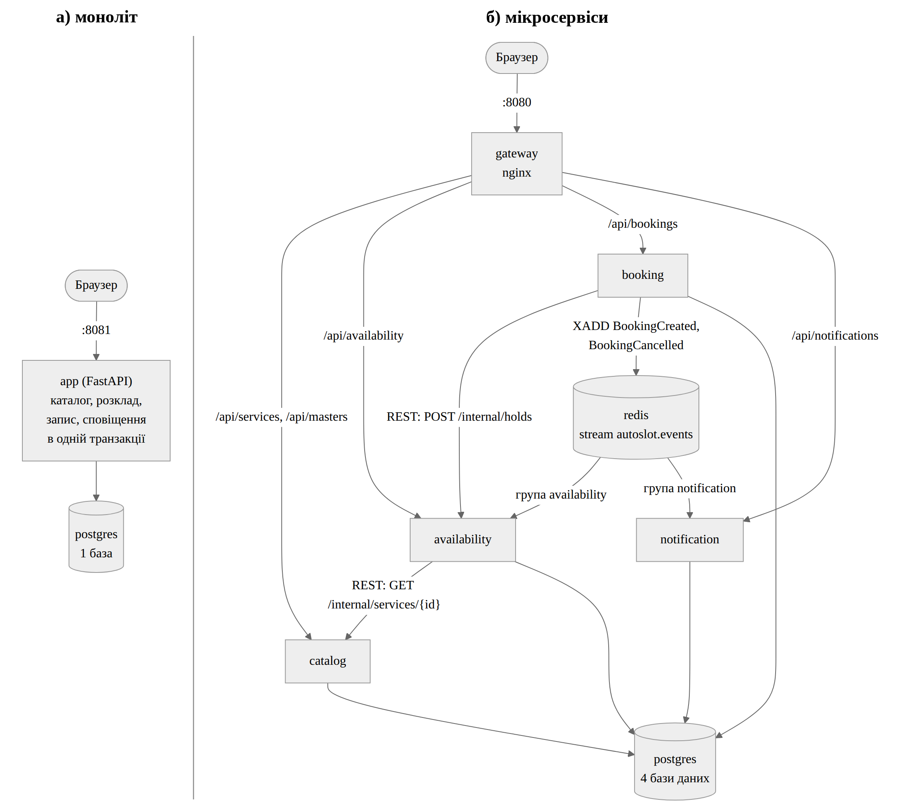
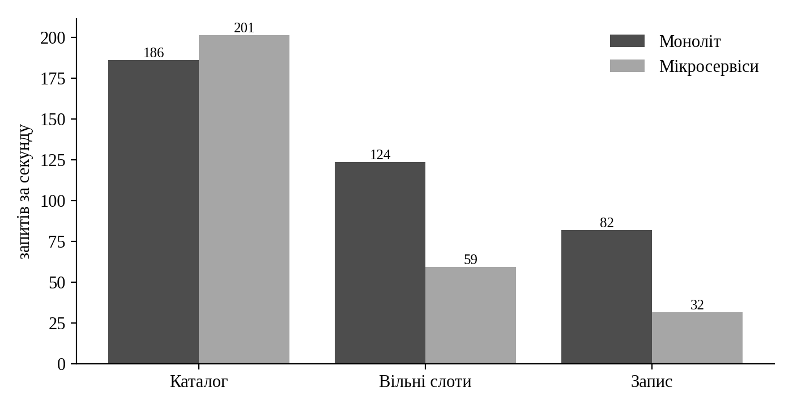
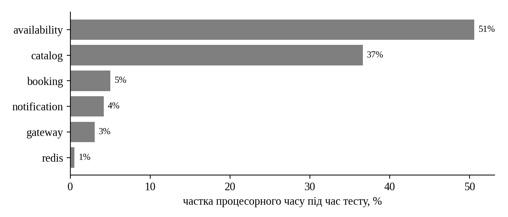

# Звіт до лабораторної роботи 3

**Дисципліна:** Хмарні та GRID-технології
**Викладач:** Жереб К. А.
**Завдання:** Лабораторна робота 3. Порівняння монолітної та мікросервісної архітектури
**Варіант:** тема обрана бригадою
**Виконали:** Захарчук Захар Сергійович, Кондрасюк Ярослав Володимирович, група ІТ-51мн
**Код:** [lab3-comparison](https://github.com/yaroslavkondrasiuk/autoslot-cloud/tree/cloud-lab3/lab3-comparison) і мікросервісна версія [lab2-containers](https://github.com/yaroslavkondrasiuk/autoslot-cloud/tree/cloud-lab3/lab2-containers) (тег `cloud-lab3`)

## 1. Розподіл обов'язків

Запланований розподіл; фактичний внесок видно в історії комітів.

| Учасник | Роль | Компоненти та розділи звіту |
| --- | --- | --- |
| Захарчук Захар Сергійович | backend-розробник, DevOps | монолітна версія (модуль сповіщень, Dockerfile, Compose), пул HTTP-з'єднань в availability; розділи 2, 4.3, 4.4, 4.6 |
| Кондрасюк Ярослав Володимирович | тестувальник, аналітик | інструменти вимірювань (`benchmark/`), проведення вимірювань, пул HTTP-з'єднань у booking; розділи 1, 3, 4.1, 4.2, 4.5, 5, висновки |

## 2. Дві реалізації

Обидві версії реалізують однакову функціональність AutoSlot: каталог послуг,
розрахунок вільних слотів, запис і скасування, SMS-підтвердження та нагадування.
Публічне API і веб-клієнт однакові. Однаковість поведінки перевірено одним і тим
самим smoke-тестом з лабораторної 2: усі 9 перевірок пройшли на обох версіях.



| | Моноліт (`monolith/`) | Мікросервіси (`lab2-containers/`) |
| --- | --- | --- |
| процеси | один FastAPI-застосунок | gateway, catalog, availability, booking, notification |
| дані | одна база PostgreSQL | окрема база на кожен сервіс |
| виклики між модулями | виклик функції | HTTP (booking → availability → catalog) і події через Redis Streams |
| сповіщення | у тій самій транзакції, що й запис | асинхронно за подією `BookingCreated` |
| контейнери | 2 (app, postgres) | 7 |

Моноліт побудовано на коді лабораторної 1, до якого додано модуль
`app/notifications.py`. Сповіщення створюються в тій самій транзакції БД, що й
запис, тож запис і підтвердження зберігаються разом або не зберігаються взагалі.

## 3. Методика вимірювань

Обидві версії запускалися як звичайні процеси на одній машині: 1 vCPU (Intel Xeon
2.8 ГГц), 4 ГБ RAM, Ubuntu 24.04, Python 3.12, PostgreSQL 16, Redis 7, nginx 1.24.
Кожен сервіс працював як один процес uvicorn, обидві версії використовували один
сервер PostgreSQL. Генератор навантаження працював на тій самій машині. Тому
абсолютні значення варто сприймати як порівняльні, а не як граничні можливості
системи. Кожна версія тестувалась тричі на чистих БД; у таблицях наведено медіану.

Інструменти в каталозі `benchmark/`:

- `bench.py` — генератор навантаження на `httpx.AsyncClient` ([async](https://www.python-httpx.org/async/)).
  Задану кількість запитів виконують N паралельних корутин. Обчислюються RPS і
  перцентилі затримки p50, p95, p99. Сценарії:
  - каталог: `GET /api/services`;
  - вільні слоти: `GET /api/availability`;
  - запис: `POST /api/bookings`, кожен запит на окремий вільний слот;
  - затримка появи підтвердження в `GET /api/notifications`.
- `proc_stats.py` — процесорний час і пам'ять (RSS) кожного процесу через psutil
  ([Process](https://psutil.readthedocs.io/en/latest/#process-class)). У Docker
  аналог — [`docker stats`](https://docs.docker.com/reference/cli/docker/container/stats/).
- `fault_matrix.py` — перевіряє, які функції доступні, коли один компонент зупинено.
- `summarize.py` — рахує медіани, будує таблицю `results/summary.md` і графіки.

Готові інструменти навантаження теж розглядались:
[Locust](https://docs.locust.io/en/stable/) дає веб-інтерфейс і сценарії на Python,
[k6](https://grafana.com/docs/k6/latest/) — сценарії на JavaScript і високу
продуктивність генератора. Власний скрипт обрано, бо сценарій «запис на
унікальний вільний слот» вимагає спершу отримати слоти через API, а результат
потрібен у JSON для автоматичного зведення. Скрипт займає близько 150 рядків і
запускається однаково для обох версій.

## 4. Результати

### 4.1 Швидкодія

| Сценарій | Паралельних клієнтів | RPS моноліт | RPS мікросервіси | p50 моноліт, мс | p50 мікросервіси, мс |
| --- | --- | --- | --- | --- | --- |
| каталог | 1 | 284 | 235 | 3,4 | 3,9 |
| каталог | 10 | 186 | 201 | 43,4 | 42,9 |
| вільні слоти | 1 | 132 | 75 | 7,2 | 12,8 |
| вільні слоти | 10 | 124 | 59 | 72,5 | 154,9 |
| запис | 1 | 82 | 30 | 11,1 | 31,4 |
| запис | 10 | 82 | 32 | 113,4 | 273,1 |

Повна таблиця з p95 і паралельністю 50 — у `benchmark/results/summary.md`.



Для простого читання, яке обслуговує один сервіс, результати близькі: gateway
додає близько 0,5 мс. Різниця з'являється там, де мікросервісам потрібні
мережеві виклики:

- **вільні слоти:** availability на кожен запит звертається до catalog за
  тривалістю послуги — у 1,8–2,1 раза менше RPS, ніж у моноліті;
- **запис:** ланцюжок booking → availability → catalog, дві транзакції в різних
  базах і публікація події — у 2,6–2,8 раза менше RPS.

Підтвердження в моноліті з'являється разом із записом: медіана повного циклу 18 мс.
У мікросервісах через подію воно з'являється через 39 мс. Це прояв кінцевої
узгодженості (eventual consistency).

### 4.2 Вартість мережевих викликів

Перший прогін мікросервісної версії показав ще гірші результати: 21 RPS для
вільних слотів і 10 RPS для запису. Причина була в тому, що кожен міжсервісний
виклик створював новий `httpx`-клієнт і нове TCP-з'єднання. Після переходу на
один клієнт на процес з пулом з'єднань keep-alive
([Clients](https://www.python-httpx.org/advanced/clients/),
[Resource limits](https://www.python-httpx.org/advanced/resource-limits/))
пропускна здатність зросла приблизно втричі: до 59 і 32 RPS. Результати першого
прогону збережено в `results/microservices-v1.json`. Висновок: у мікросервісах
ефективність міжсервісної взаємодії стає окремою інженерною задачею, якої в
моноліті немає.

### 4.3 Споживання ресурсів

| Показник | Моноліт | Мікросервіси |
| --- | --- | --- |
| пам'ять у спокої (RSS) | 83 МБ | 367 МБ |
| пам'ять під навантаженням | 91 МБ | 384 МБ |
| процесорний час на той самий тест | 13,2 с | 28,3 с |
| тривалість того самого тесту | 27 с | 47 с |

Кожен Python-сервіс займає 82–90 МБ у спокої незалежно від обсягу своєї логіки,
тож чотири сервіси разом з nginx і Redis потребують у 4,4 раза більше пам'яті.
На той самий обсяг роботи мікросервіси витратили в 2,1 раза більше
процесорного часу: серіалізація JSON, HTTP і робота з кількома базами.



Під час тесту 51 % процесорного часу витратив availability, а 37 % — catalog,
хоча прямих запитів до каталогу було менше половини. Більшість звернень до
catalog — внутрішні виклики від availability. Це антипатерн Chatty
Services, який ми виявили ще на етапі проєктування. Очевидне покращення —
кешувати тривалість послуг в availability або отримувати її з подій catalog.

### 4.4 Масштабованість

Мікросервісна версія дозволяє масштабувати лише навантажені компоненти:
`docker compose up -d --scale availability=3`
([docs](https://docs.docker.com/reference/cli/docker/compose/up/)). Сервіси без
стану (catalog, availability, booking) масштабуються горизонтально, а consumer
groups у Redis Streams розподіляють події між екземплярами notification
автоматично. Моноліт масштабується лише цілком: кожна копія містить усі модулі.

Вимірювання показують, що для застосунку такого розміру ця перевага поки
теоретична. Додатковий екземпляр availability займає близько 100 МБ, стільки ж,
скільки ціла копія моноліту (91 МБ). Тому три копії моноліту за балансувальником
дадуть більше пропускної здатності за менші ресурси, ніж мікросервіси з трьома
availability. Незалежне масштабування стає вигідним, коли компоненти суттєво
відрізняються за ресурсами (наприклад, обробка медіа чи звітів) або коли команди
розробки різні.

Обмеження експерименту: на 1 vCPU приріст від горизонтального масштабування
виміряти неможливо, бо всі процеси ділять одне ядро. Крім того, nginx визначає
адреси сервісів під час старту, тож після `--scale` gateway треба перезапустити.

### 4.5 Відмовостійкість

Результат `fault_matrix.py` для зупинки одного компонента, де + означає, що функція працює:

| Зупинено | каталог | вільні слоти | запис | мої записи | сповіщення |
| --- | --- | --- | --- | --- | --- |
| моноліт: процес app | – | – | – | – | – |
| мікросервіси: notification | + | + | + | + | – |
| мікросервіси: availability | + | – | – | + | + |
| мікросервіси: catalog | – | – | – | + | + |
| мікросервіси: booking | + | + | – | – | + |
| мікросервіси: redis | + | + | помилка 500 | + | + |

У мікросервісах відмова компонента вимикає лише залежні від нього функції. Збій
сервісу сповіщень зовсім не впливає на запис, а пропущені події обробляються після
відновлення (перевірено в лабораторній 2). Водночас з'явилась нова проблема
узгодженості. Коли Redis недоступний, booking зберігає запис, але не може
опублікувати подію і повертає клієнту 500, хоча запис уже існує, а слот лишається
в стані hold, а через 5 хвилин hold протермінується, і цей час можуть
зайняти повторно. Повноцінне рішення — шаблон
[transactional outbox](https://microservices.io/patterns/data/transactional-outbox.html).
У моноліті такої ситуації немає, бо запис і сповіщення фіксуються однією транзакцією.

### 4.6 Розробка та розгортання

| Критерій | Моноліт | Мікросервіси |
| --- | --- | --- |
| код Python (непорожні рядки) | 329 у 7 файлах | 557 у 13 файлах |
| інфраструктурна конфігурація | 40 рядків, 2 файли | 139 рядків, 5 файлів |
| контейнери / власні образи | 2 / 1 | 7 / 5 |
| час старту до готовності | 0,9 с | 3,4 с (сервіси стартують за ланцюжком залежностей) |
| автотести | in-process через TestClient, без зовнішніх залежностей | потрібна вся система (smoke-тест через gateway) |
| налагодження | один стек викликів, один журнал | журнали п'яти сервісів, кореляція через `X-Request-ID` |
| зміна «додати поле до SMS» | 1 файл, одне розгортання | payload події в booking і обробник у notification, узгоджене розгортання двох сервісів |
| незалежне розгортання | ні | так, кожен сервіс окремо |

Мікросервіси потребують на 70 % більше коду: HTTP-клієнти, схеми подій,
ідемпотентність обробників, очищення протермінованих hold. Також потрібно в 3,5 раза
більше інфраструктурної конфігурації. Натомість кожен сервіс простіший окремо, і
його можна змінювати та розгортати без інших.

## 5. Запуск

```bash
cd lab3-comparison/monolith && cp .env.example .env && docker compose up -d --build   # :8081
cd lab2-containers          && cp .env.example .env && docker compose up -d --build   # :8080
cd lab3-comparison/benchmark && pip install httpx psutil matplotlib
python bench.py --base http://localhost:8081 --label monolith-r1
python bench.py --base http://localhost:8080 --label microservices-r1
python summarize.py
```

Автотести моноліту: `cd lab3-comparison/monolith && pip install -r requirements.txt pytest httpx && pytest -q`.

## 6. Висновки

Для AutoSlot у поточному масштабі моноліт виграє за швидкодією: у 1,8–2,8 раза
більше RPS на операціях, що зачіпають кілька модулів. Він також економніший за
ресурсами (у 4,4 раза менше пам'яті, у 2,1 раза менше процесорного часу), простіший
у розробці, тестуванні й розгортанні та забезпечує строгу узгодженість однією транзакцією.

Мікросервіси виграють в ізоляції відмов, незалежному розгортанні та
вибірковому масштабуванні. Ціна цього — мережеві виклики, кінцева узгодженість і
нові класи помилок (втрата події при недоступності брокера). Вимірювання також
показали, що ефективність мікросервісів сильно залежить від інженерних деталей:
лише повторне використання HTTP-з'єднань дало триразовий приріст. Розподіл
навантаження за компонентами підтвердив антипатерн Chatty Services між
availability і catalog.

Рекомендація для проєкту: розвивати систему як модульний моноліт з чіткими
межами модулів, що відповідають сервісам. Першим кандидатом на виділення є
notification: він слабко зв'язаний з рештою, працює асинхронно, і його відмова не
повинна впливати на запис. Такий підхід відповідає стратегії
[MonolithFirst](https://martinfowler.com/bliki/MonolithFirst.html).
