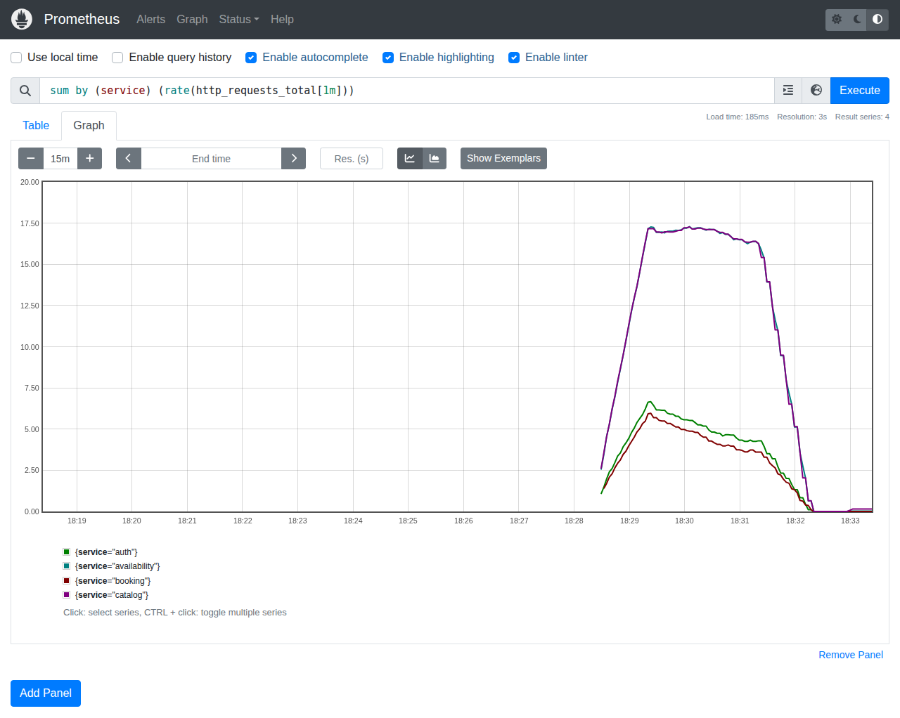
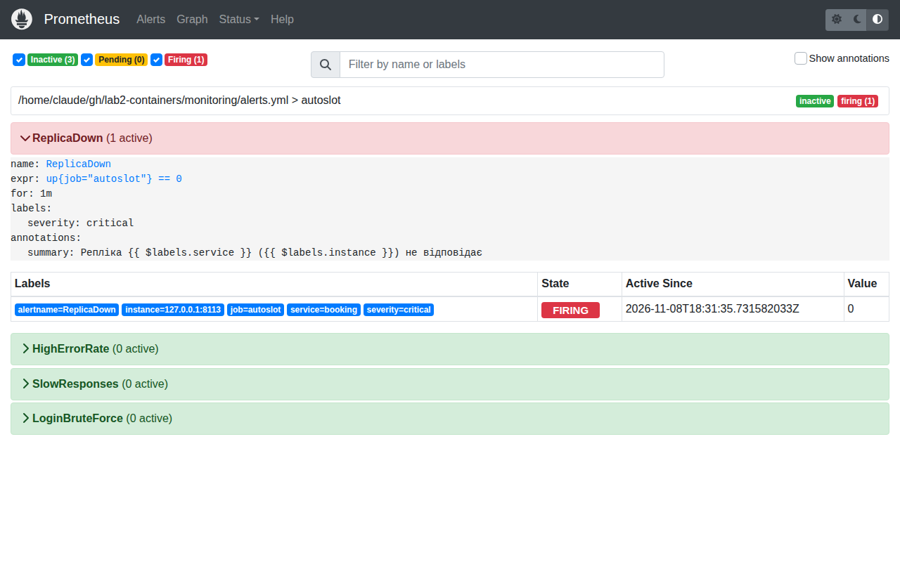

# Звіт до лабораторної роботи 4

**Дисципліна:** Хмарні та GRID-технології
**Викладач:** Жереб К. А.
**Завдання:** Лабораторна робота 4. Використання сучасних інструментальних засобів для керування хмарними ресурсами
**Варіант:** тема обрана бригадою
**Виконали:** Захарчук Захар Сергійович, Кондрасюк Ярослав Володимирович, група ІТ-51мн
**Код:** [lab4-cloud-tools](https://github.com/yaroslavkondrasiuk/autoslot-cloud/tree/cloud-lab4/lab4-cloud-tools), [.github/workflows](https://github.com/yaroslavkondrasiuk/autoslot-cloud/tree/cloud-lab4/.github/workflows), [lab2-containers/monitoring](https://github.com/yaroslavkondrasiuk/autoslot-cloud/tree/cloud-lab4/lab2-containers/monitoring) (тег `cloud-lab4`)

## 1. Розподіл обов'язків

| Учасник | Роль | Компоненти та розділи звіту |
| --- | --- | --- |
| Захарчук Захар Сергійович | DevOps | Terraform, розгортання через GitHub Actions; розділи 3, 4.2 |
| Кондрасюк Ярослав Володимирович | розробник, тестувальник | метрики в сервісах, Prometheus, Grafana, CI-тести, навантаження; розділи 2, 4.1, 5, висновки |

## 2. Що зроблено

Інструменти показано на мікросервісній версії AutoSlot з лабораторної 2. З напрямків,
які перелічує завдання, обрано три:

1. **Спрощення розгортання — Terraform.** Уся інфраструктура AWS (ВМ, мережеві
   правила, ключ, запуск застосунку) описана кодом. Раніше ми створювали її вручну
   командами AWS CLI.
2. **Спрощення оновлення — GitHub Actions.** Після кожного push тести й збірка
   запускаються автоматично, а успішна версія сама розгортається на ВМ.
3. **Збір інформації про застосунок — Prometheus і Grafana.** Метрики всіх реплік,
   дашборд і правила сповіщень про проблеми.

Автомасштабування не обрали. На одній ВМ із Docker Compose його не зробити: потрібна
група автомасштабування EC2 або AWS ECS. Це значно складніше і дорожче для навчального
проєкту. Ручне масштабування (`REPLICAS`) і моніторинг, який показує, коли воно потрібне,
у нас є.

## 3. Terraform: інфраструктура як код

Конфігурація лежить у `lab4-cloud-tools/terraform/` ([Terraform language](https://developer.hashicorp.com/terraform/language)):

| Файл | Що описує |
| --- | --- |
| `versions.tf` | провайдер AWS ~> 5.0 і спільні теги для всіх ресурсів (`default_tags`) |
| `variables.tf` | параметри: регіон, тип ВМ, IP адміністратора, кількість реплік, секрети |
| `main.tf` | образ Ubuntu, ключ SSH, security group, ВМ |
| `cloud-init.sh.tftpl` | скрипт першого запуску ВМ: Docker, код, `.env`, `docker compose up` |
| `outputs.tf` | адреса сайту, Grafana, команда SSH |

Використані можливості:

- [`data "aws_ami"`](https://registry.terraform.io/providers/hashicorp/aws/latest/docs/data-sources/ami) —
  щоразу знаходить найсвіжіший офіційний образ Ubuntu 24.04, а не прописаний вручну ID.
- [`aws_security_group`](https://registry.terraform.io/providers/hashicorp/aws/latest/docs/resources/security_group) —
  сайт (8080) відкритий усім, а SSH і Grafana — лише з IP адміністратора.
- [`aws_instance`](https://registry.terraform.io/providers/hashicorp/aws/latest/docs/resources/instance):
  - зашифрований диск;
  - IMDSv2: метадані ВМ доступні лише з токеном, що захищає від SSRF;
  - `instance_initiated_shutdown_behavior = "terminate"` разом із `shutdown` у скрипті
    видаляють забуту ВМ через заданий час.
- [`templatefile`](https://developer.hashicorp.com/terraform/language/functions/templatefile) —
  підставляє параметри й секрети в скрипт першого запуску.
- [Перевірка змінних](https://developer.hashicorp.com/terraform/language/values/variables#custom-validation-rules)
  (`validation`): не можна задати доступ до SSH для всіх (`0.0.0.0/0`) чи короткий
  секрет. Позначка `sensitive` ховає секрети з виводу.

```bash
cd lab4-cloud-tools/terraform
cp terraform.tfvars.example terraform.tfvars    # IP, пошта адміна, паролі
terraform init
terraform plan        # що буде створено
terraform apply       # створити; через 3–5 хв сайт працює за адресою з app_url
terraform destroy     # прибрати все
```

| | AWS CLI вручну (ЛР2) | Terraform |
| --- | --- | --- |
| створення | ~10 команд по черзі, ID копіюються вручну | одна команда `apply` |
| видалення | треба пам'ятати всі ресурси, key pair і security group лишались | `destroy` прибирає все, що створено |
| повторюваність | залежить від того, хто виконує | однаковий результат з тих самих файлів |
| зміни | невідомо, що вже змінено | `plan` показує різницю до застосування |

**Альтернативи.**
- AWS CloudFormation — лише AWS.
- Pulumi — інфраструктура звичайною мовою програмування.
- OpenTofu — відкрита гілка Terraform, сумісна з ним.

Terraform обрано як найпоширеніший інструмент, що працює з різними хмарами.

**Результати.** ⟨вивід `terraform apply` і `terraform output`, скріншот ВМ у консолі AWS⟩

## 4. GitHub Actions: автоматичні перевірки й розгортання

Синтаксис робочих процесів: [workflow syntax](https://docs.github.com/en/actions/writing-workflows/workflow-syntax-for-github-actions).

### 4.1 CI (`.github/workflows/ci.yml`)

На кожен push і pull request запускаються три задачі:

1. **Модульні тести** лаб 1, 2 і 3.
2. **Наскрізний тест.** Збираються всі образи, система піднімається в Docker на сервері
   GitHub, і запускається smoke-тест на 20 перевірок. `docker compose up --wait`
   ([docs](https://docs.docker.com/reference/cli/docker/compose/up/)) чекає, поки всі
   контейнери стануть healthy. Якщо щось упало, у журнал виводяться логи контейнерів.
3. **Перевірка Terraform:** `fmt -check` і `validate`.

### 4.2 Розгортання (`.github/workflows/deploy.yml`)

- Запускається після успішного CI на гілці `main`
  ([`workflow_run`](https://docs.github.com/en/actions/writing-workflows/choosing-when-your-workflow-runs/events-that-trigger-workflows#workflow_run))
  або вручну.
- Через SSH переходить на ВМ, отримує потрібний коміт і виконує
  `docker compose up -d --build --wait`. Перезбираються лише змінені образи, і перезапускаються
  лише змінені контейнери.
- Наприкінці перевіряє, що сайт відповідає.
- Адреса ВМ і SSH-ключ зберігаються в
  [секретах репозиторію](https://docs.github.com/en/actions/security-for-github-actions/security-guides/using-secrets-in-github-actions).
  Без них розгортання просто пропускається.
- [`concurrency`](https://docs.github.com/en/actions/writing-workflows/choosing-what-your-workflow-does/control-the-concurrency-of-workflows-and-jobs)
  не дає двом розгортанням іти одночасно.

**Альтернативи.**
- GitLab CI — аналог, але для GitLab.
- Jenkins — потрібен власний сервер.
- AWS CodePipeline — прив'язка до AWS.

GitHub Actions обрано, бо репозиторій уже на GitHub, і для нього не потрібна окрема інфраструктура.

**Результати.** ⟨посилання на успішний запуск CI і Deploy, скріншот⟩

## 5. Моніторинг: Prometheus і Grafana

### 5.1 Як влаштовано

**Метрики в сервісах.** Модуль `services/common/metrics.py` з бібліотекою
[prometheus_client](https://prometheus.github.io/client_python/) додає до кожного
сервісу `GET /metrics` і проміжний обробник, який міряє кожен запит:

- `http_requests_total` — кількість запитів за сервісом, методом, маршрутом і кодом
  відповіді;
- `http_request_duration_seconds` — гістограма тривалості
  ([histograms](https://prometheus.io/docs/practices/histograms/)), з якої рахуються
  перцентилі;
- пам'ять і процесорний час кожного процесу;
- бізнес-метрики: створені й скасовані записи, конфлікти слотів, входи, невдалі спроби
  входу, листи.

Шлях `/metrics` закритий на gateway, тож метрики доступні лише всередині мережі Docker.

**Prometheus** (`monitoring/prometheus.yml`) раз на 15 с збирає метрики з усіх реплік.
Репліки знаходяться через DNS Docker
([`dns_sd_config`](https://prometheus.io/docs/prometheus/latest/configuration/configuration/#dns_sd_config)),
тому нова репліка після масштабування з'являється в моніторингу сама.

**Правила сповіщень** (`monitoring/alerts.yml`,
[alerting rules](https://prometheus.io/docs/prometheus/latest/configuration/alerting_rules/)):

| Правило | Коли спрацьовує |
| --- | --- |
| `ReplicaDown` | репліка не відповідає довше 1 хв |
| `HighErrorRate` | понад 5 % відповідей сервісу — помилки 5xx |
| `SlowResponses` | p95 часу відповіді понад 0,5 с |
| `LoginBruteForce` | понад 20 невдалих спроб входу за хвилину |

**Grafana** налаштовується автоматично
([provisioning](https://grafana.com/docs/grafana/latest/administration/provisioning/)):
джерело даних і дашборд «AutoSlot — стан системи» підключаються при старті. На дашборді
10 панелей:
- живі репліки;
- запити за секунду;
- p95 часу відповіді;
- частка помилок 5xx;
- відмови 4xx за кодом;
- пам'ять і процесор кожної репліки;
- записи;
- входи;
- листи.

Моніторинг вмикається профілем: `docker compose --profile monitoring up -d`.

### 5.2 Результати

Систему з 10 репліками навантажено скриптом `scripts/load.py` протягом 3 хвилин:
- 3 користувачі переглядали каталог, шукали вільний час, записувались і частину записів
  скасовували;
- паралельно йшли запити без входу і з невірним кодом.

Усього 6044 запити, 359 записів, 108 скасувань. Prometheus працював локально, з тими
самими правилами, що й у compose. Дані зібрані в `results/monitoring-results.json`.

| Сервіс | Пік, запитів/с | p95 під навантаженням, мс | Пам'ять репліки, МБ |
| --- | --- | --- | --- |
| catalog | 17,2 | 20,6 | 81–82 |
| availability | 17,2 | 46,5 | 89 |
| booking | 5,5 | 47,6 | 90 |
| auth | 6,2 | 4,9 | 88 |
| notification | — | — | 84 |



Що показав моніторинг:

- **Auth отримав 13 % усіх запитів, хоча користувачі входили лише тричі.** Причина в тому,
  що gateway питає auth перед кожним захищеним запитом (`auth_request`). Кожна операція з
  записами — це додатковий запит до auth. Він обробляється за 5 мс, тож зараз це не
  проблема. Але при зростанні навантаження варто кешувати результат перевірки в nginx або
  перевіряти JWT прямо в gateway.
- **Availability і booking найповільніші (p95 близько 47 мс).** Availability на кожен запит
  звертається до catalog, а booking — до availability. Це той самий ланцюжок мережевих
  викликів, який ми виміряли в ЛР3.
- **Кожна репліка займає 80–90 МБ незалежно від навантаження.** Отже, 10 реплік — це
  близько 870 МБ лише на Python-процеси. Це треба враховувати, обираючи розмір ВМ.
- **Сповіщення про відмову працює.** Ми зупинили одну репліку booking, і через хвилину
  правило `ReplicaDown` перейшло в стан firing. Запити тим часом обробляла друга репліка.



Корисне спостереження: лічильники Prometheus обнуляються при перезапуску репліки. Тому
сумарні значення треба рахувати через `increase()` або `rate()`, які це враховують, а не
просто додавати поточні значення лічильників.

**Альтернативи.**
- AWS CloudWatch — не потребує окремих контейнерів, але метрики застосунку платні, і є
  прив'язка до AWS.
- Datadog — платний.
- Loki або ELK — для журналів, а не метрик. Це наступний крок.

⟨скріншот дашборду Grafana з розгорнутої ВМ⟩

## 6. Висновки

Три інструменти закрили три різні задачі керування хмарним застосунком:
- **Terraform** замінив ручні команди відтворюваним описом інфраструктури, який
  створюється й видаляється однією командою.
- **GitHub Actions** гарантує, що на сервер потрапляє лише перевірений код: тести й
  наскрізна перевірка в справжньому Docker. Оновлення відбувається без ручних дій.
- **Prometheus і Grafana** дали видимість того, що відбувається всередині системи.
  Моніторинг одразу виявив неочевидну річ — навантаження на auth через перевірку кожного
  запиту — і підтвердив висновки ЛР3 про вартість мережевих викликів.
